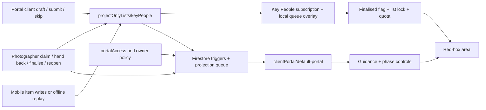

# Key People — status and actions audit

Source reviewed on `stabilize` at `9ac94ac18630919f9709c010639c3b469c3f12e7`. This is a static audit. The supplied screenshot shows the upcoming, shared, finalised state. The red box contains its intro and Unlock card. This report includes replacement states in the same area and list, dialog and backend behaviour that determines what the header can truthfully say. See [Shared data flows and plan access](C:/Users/PC/.codex/visualizations/2026/11/20/01a1f6c0-ed74-7553-9236-44bbec7d0b35/portal-screen-audit/shared.md) for the cross-screen mechanisms.

## What can appear in the box

The screen uses a padded `StandardAppStack` with `sectionContent` spacing and centred `StandardAppText` with the `editorialBody` role. It renders only the guidance **description**. The mapper also returns a title, overline, stage index/label/tone and warning flag, but the Key People screen does not display any of those fields. There is no phase stepper or progress counter in this box. The phase action is rendered under the intro and requires that guidance exists. The portal actions and the list permissions are derived separately.

| First applicable state | On-screen copy and contents | Actions and behaviour |
| --- | --- | --- |
| Plan resolving or initial list load without a snapshot | Shell list loading replaces the body. The intro independently waits for feature access and for portal loading if no cached portal exists. | No create control while blocked on initial load. Already loaded list content can remain during refresh. |
| Plan resolved with feature disabled or no usable feature object | Locked `InfoCard` with “Plan locked” and the registry’s plan-locked message for Key people. | “View plans” opens Pricing. |
| Entitled project with a missing list | `ListRecoveryCard`: “Key people list not found. The key people list for this project is missing. You can recreate it to start managing key people.” | Repair checks the scoped document again, then displays “Recreate List” and the empty-list or existing-data overwrite warning. “Recreate” sends the empty list through the existing online save path. Errors appear as toasts, and the action remains available. |
| Initial list error without data | Shell error with retry. | Retry reloads the list and portal. |
| Event complete | “This section is read-only now the event is over.” | No portal action, add, edit or delete. |
| Wedding day | “The client portal is closed. Use this list to find people and keep the day on track.” | No portal action or Unlock. A locally unfinalised list can still be edited on the wedding day subject to its feature flags and quota. A locally finalised list stays locked. |
| Upcoming, no portal entitlement, no portal document or no included step | “Add the people you need to find and photograph on the day.” An unshared step changes the hidden overline only. | Opens no portal workflow for absent portal or step. A portal document still present after an entitlement change can leave the standalone action hook evaluating it independently of that entitlement. |
| Upcoming, included step, portal inactive, disabled, expired or finalised as projected | “Your client can no longer edit this section. You can add and edit here.” | No takeover or hand-back. A locally finalised shared section can still show Unlock. |
| Upcoming, live step, finalised according to the list or portal projection | “This section is finalised and locked in the client portal.” | If finalised according to the list **and** a projected step exists, a titleless/iconless raised `SectionFinalizationActionCard` shows “Unlock Key People to add, edit, or delete people again.” and a full-width primary “Unlock Key People” button. |
| Upcoming, live step, photographer turn | “Your client has submitted this section. Review it below.” | Primary “Finalise section” when a list object exists, even when `items` is empty. Secondary “Hand back to client”. Both are full-width small buttons with `captionMeta` labels. |
| Upcoming, live step, client turn | “Your client is adding key people in the portal.” | Full-width small primary “Take over this section” with a `captionMeta` label. List mutations unavailable while the canonical list is client-owned. |
| Upcoming, live step, projected `actionOn: none` with non-finalised status | Same client-turn sentence. | `not_started` in the status mapper yields no takeover button. A canonical projection rebuild normally avoids this combination. |

Once list permissions resolve, the people limit can **replace** the phase sentence with “You have reached the people limit for your plan ({{limit}}). Upgrade to add more.” The hook supplies this message only if the plan allows adding and ownership, lifecycle and finalisation permit it. It can therefore replace wedding-day or review guidance while existing rows remain editable and review actions remain visible. If `canAdd=false` for another reason, there is no replacement capacity message. If a stale list exists on error, the screen displays a plain compact error **after** the guidance/actions with “Couldn’t refresh this list”, “Showing the last loaded key people. Pull down to retry.” and “Retry”. If empty, the raised empty state follows the intro, with “No Key People Yet”, “Add important people like the Maid of Honour or Best Man.” and a conditional “Add key person” CTA. On a nonempty list the same create action is a FAB below the audit region. Neither create control should run at capacity or while the local list is locked.

[Screen and render branches](<C:/eye-doo-monorepo/apps/mobile/src/app/(protected)/(app)/(dashboard)/(home)/key-people.tsx:66>) · [Guidance precedence](C:/eye-doo-monorepo/apps/mobile/src/utils/presentation/portal-step-status-card.ts:29) · [Access and data guard](C:/eye-doo-monorepo/apps/mobile/src/hooks/dashboard/use-portal-step-status-card.ts:29) · [Workflow controls](C:/eye-doo-monorepo/apps/mobile/src/hooks/dashboard/use-section-phase-portal-action.tsx:157) · [Phase copy](C:/eye-doo-monorepo/apps/mobile/src/i18n/dictionaries/dashboard-lists-en.ts:102) · [List copy](C:/eye-doo-monorepo/apps/mobile/src/i18n/dictionaries/dashboard-home-en.ts:560) · [Recovery copy](C:/eye-doo-monorepo/apps/mobile/src/i18n/dictionaries/shared-components-en.ts:165)

Mobile resolves to en-GB. Legacy stored Spanish is coerced to English; the Spanish dictionary scaffold does not introduce another displayed Key People variant. Portal client copy has separate locale resources. [Mobile locale resolver](C:/eye-doo-monorepo/apps/mobile/src/i18n/resolve-locale.ts:15)

## Plan and day gates

Feature access is driven by the subscription catalogue and lifecycle. Key People uses `keyPeople.enabled` for access and `keyPeople.canAdd` plus `maxPerProject` for growth. Edit/delete are independent of the add flag and cap. `canAddAvatar` and `maxAvatars` apply to attached avatar writes and quotas. `rolesAndTags` and `portalSync` exist as feature fields, but neither decides the header or its portal actions. A portal step needs the overall portal feature plus `portalKeyPeople.enabled` and `clientCanAdd` on the server. That feature has its own `maxCount` and `canAddAvatar`. Portal writes may also have to pass the canonical project's item and image quota; Key People counts **all retained rows**, including photographer rows. A lower limit permits existing data and non-growth operations where policy permits them. A limit of `-1` is unlimited.

| Plan | Repo E2E plan seed, not a live catalogue reading |
| --- | --- |
| FREE during active trial | Feature and client add enabled. 8 project people and 8 portal people, 10 project avatars, offline sync on. |
| BASIC | Feature and client add enabled. 2 project people and 2 portal people, 10 project avatars, offline sync off. |
| PRO | Feature and client add enabled. 4 project people and 4 portal people, 10 project avatars, offline sync on. |
| STUDIO | Feature and client add enabled. 8 project people and 8 portal people, 10 project avatars, offline sync on. |

An expired FREE trial or inactive paid entitlement can leave readable data while business writes are unavailable. Paywall/bootstrap routing and server authorization use billing lifecycle, outside this screen. The box has no separate trial countdown, expiry warning or paid-offer state. Paid trials inherit the purchased tier's feature gates while active. The catalogue quota audit recorded four live plans in SHIP but does not establish each plan's live Key People number for this report.

Mobile requires `isEnabled===true`, `accessStatus==='active'`, step inclusion and an upcoming wedding to consider the step live. Missing event date falls through to upcoming. Mobile derives day boundaries using the user's timezone and a ticking clock. Portal client writes and owner reopen/review use the server's owner timezone guard. Portal expiry is projected and independently checked on the backend. The mobile live-step helper does not compare `expiresAt` to its local clock. Access states outside active share a closed presentation if the projected step still exists; the current portal cursor (`currentStepID`), step order, and whether the client currently views this step do not directly affect the box.

[Feature access](C:/eye-doo-monorepo/apps/mobile/src/utils/feature-access.ts:414) · [Plan fields](C:/eye-doo-monorepo/apps/mobile/src/domain/subscription/plan.schema.ts:68) · [Portal entitlements](C:/eye-doo-monorepo/packages/domain/src/project/portal-entitlements.schema.ts:16) · [Seed matrix](C:/eye-doo-monorepo/apps/mobile/scripts/seed-e2e-data.js:209) · [Lifecycle](C:/eye-doo-monorepo/packages/domain/src/common/billing-values.ts:94) · [Live step](C:/eye-doo-monorepo/packages/domain/src/portal/section-ownership.ts:40) · [Mobile calendar](C:/eye-doo-monorepo/apps/mobile/src/hooks/use-event-calendar.ts:8)

## Persisted state and data flow

| Document or shape | Fields relevant to the header |
| --- | --- |
| `projects/{projectId}` and `users/{ownerId}` | Event date, owner/user ID, timezone preference and subscription lifecycle. Separate `subscriptionPlans/{plan}` catalogue controls access and limits. |
| `projects/{projectId}/projectOnlyLists/keyPeople` | `config` plus optional categories, `items[]` and `pendingUpdates[]` (defaults empty). Config has ID, list type/source, version/defaults, creator/modifier IDs, integer counts and timestamps. Workflow fields are `status: unlocked\|review\|locked\|finalized`, `actionOn: client\|photographer\|none`, booleans `finalized`, `skipped`, and optional legacy `locked`. Timestamps `clientLastViewed`, `clientSubmittedAt`, `updatedAt`, `approvedAt`, `skippedAt`, `revisionRequestedAt` and `clientReviewConfirmedAt` are nullable/optional. Optional workflow metadata includes `approvedBy`, `revisionRequested`, `revisionReason` (max 1000), `revisionRequestedBy`, `skippedByClient` and integer `lastNotifiedSubmittedAtMs`. The box uses item count from actual items and uses canonical finalisation, not those submission, skip or revision flags. |
| Key People item | ID, `itemName`, optional `itemDescription` (up to notes-length limit), `displayName`, explicit role enum or `null`, boolean `isVIP`, `canRallyPeople`, `mustPhotograph`, `dontPhotograph`; nullable optional `notes`, free-text `involvement`, `avatar`; creator/editor enum and creation timestamp. Base fields include optional `categoryId` and default-false `isCustom/isChecked/isDisabled`. Item IDs must be unique. UI count, empty/unavailable path and lock matter to the box. The records are not shown inside the red box. |
| `portalAccess/{projectId}` | Server access state, expiry/token hash, selected step configuration, required/optional flag, owner/plan and link metadata. |
| `projects/{projectId}/clientPortal/default-portal` | Mobile-facing projection. Box input is chiefly `isEnabled`, `accessStatus`, and `steps[].id/stepStatus/actionOn`. Step schema includes title, number, icon, optional description, required flag and legacy alias `portalStepID`. Builder emits item count and last updated metadata, neither rendered here. Root legacy stats are accepted alongside `metadata`. |

The status parser gives explicit canonical `status` precedence over legacy `finalized` or `locked` fallbacks and throws for a noncanonical explicit value. The screen's `isFinalized` explicitly ORs the parsed `finalized` Boolean with canonical status. The projection derives its turn from canonical status, ignoring the stored raw `actionOn`: unlocked → client, review/locked → photographer, finalized → none. The live local CRUD helper similarly uses the canonical status. Finalise and hand-back authorisation also require the persisted raw owner, creating an important distinction from the header's projected ownership.

[Project document path](C:/eye-doo-monorepo/apps/mobile/src/repositories/firestore/paths/firestore-list-paths.ts:57) · [List schema](C:/eye-doo-monorepo/packages/domain/src/project/key-people.schema.ts:44) · [Base config](C:/eye-doo-monorepo/packages/domain/src/common/list-base.schema.ts:32) · [Portal schema](C:/eye-doo-monorepo/packages/domain/src/project/portal.schema.ts:33) · [Status parser](C:/eye-doo-monorepo/packages/domain/src/portal-contract.ts:187) · [Projection builder](C:/eye-doo-monorepo/apps/functions/portal/portalProjection.ts:392)

## What changes the header and when

| Trigger | Writes and resulting state |
| --- | --- |
| Mobile project creation or confirmed recovery | Creates an empty `unlocked` section with `actionOn:none`, `finalized:false`, zero counts and empty arrays. No portal usually means editable. Projection of an included unlocked section derives client ownership independently of raw `none`. Recovery is an explicit recreation and can overwrite an existing document after the user confirms. |
| Client opens the portal or changes wizard step | Access/current-step APIs update portal access counters, activity, or `currentStepID`. These are informational for this box. No current Key People header consumer/writer uses `config.clientLastViewed`. |
| Client saves draft or autosave runs | Portal draft route forwards to `savePortalDraft`. It checks valid session/access/hash/expiry, step inclusion and entitlement, owner lifecycle/date, unlocked/unfinalised section and quota. Canonical merge preserves protected photographer rows and creation provenance, allows omitted client rows to be removed, validates changed rows and unique IDs, writes items, derived list metadata and `config.updatedAt`. Turn is unchanged. |
| Client submits | Transaction reuses the draft merge and quota checks. A required section with zero persisted items fails. Writes items/derived metadata, `locked/photographer`, `clientSubmittedAt` and `updatedAt` server timestamps, and clears revision and legacy lock metadata. On the mobile list listener this makes rows editable for the photographer before the independent projection necessarily catches up. Submit trigger can send Expo push or Brevo email once per submission timestamp and records `lastNotifiedSubmittedAtMs`. |
| Client skips an optional writable step | Writes `finalized/none`, `finalized:true`, `skipped:true`, `skippedByClient:true`, `skippedAt`, `updatedAt` and clears revision/confirmation metadata. Existing items remain. Mobile currently presents this as generic finalisation. |
| Client confirms review where the portal offers it | The legacy `confirm-review` API requires a permitted review transition and raw client turn. Writes `unlocked/client` and `clientReviewConfirmedAt`, clears the legacy lock. It does not treat photographer-owned review as client-editable. |
| Photographer taps “Take over this section” | Confirmation says “Your client will no longer be able to edit this section in the portal. Anything they have added stays.” “Take over” calls `claimPortalSection`. A claim requires entitlement, selected step, existing section and canonical unlocked/unfinalised state. Writes `locked/photographer`, clears revision/confirmation and legacy lock, updates timestamp; items are retained. |
| Photographer taps “Hand back to client” | Confirmation says the client can edit again and will see the note. Multiline “Note to your client” defaults to “Handed back to you to complete”. Blank trim is rejected locally. `requestPortalSectionRevision` sanitises the note and caps it at 1000 characters. Writes `unlocked/client`, `finalized:false`, revision requested/reason/time/by and update time, removing legacy lock and prior client-review confirmation. Existing submission/approval history may remain. |
| Photographer taps “Finalise section” | Direct action, without confirmation. `PortalService.updateStepStatus(...FINALIZED, NONE)` calls the dedicated finalise endpoint. Both finalise and revision require an entitled owner, selected step, existing document, upcoming event and exact persisted `locked/photographer`. Sets `finalized/none`, `finalized:true`, approval date/by and update time, deleting revision and legacy lock pointers. |
| Photographer taps “Unlock Key People” | Direct call to `claimPortalSection(projectId, keyPeople, true)`. Reopen requires an existing selected, finalised Key People section and before the wedding day in owner timezone. Clears `finalized` and changes ownership to `locked/photographer` while clearing revision/confirmation and legacy lock. This returns editing to the photographer. It does not regenerate an already closed portal, and old approval/submission or skip fields may remain. |
| Finalisation of all selected sections, portal disabled/expired or removed from configuration | Finalised trigger may set `portalAccess.accessStatus=finalized`, `isEnabled=false`, delete the access token hash and stamp finalisation. Other access/owner/plan changes schedule projection. Section projection trigger and explicit owner-action rebuilds refresh the projected steps. Two independent mobile listeners can deliver these changes in either order. |

[Draft callable](C:/eye-doo-monorepo/apps/functions/portal/section/draftCallables.ts:19) · [Draft merge](C:/eye-doo-monorepo/packages/domain/src/portal/draft/sectionDraftValidation.ts:128) · [Submit](<C:/eye-doo-monorepo/apps/portal/src/app/api/wedding/[projectId]/section/[sectionId]/submit/route.ts:319>) · [Skip](<C:/eye-doo-monorepo/apps/portal/src/app/api/wedding/[projectId]/section/[sectionId]/skip/route.ts:112>) · [Confirm review](<C:/eye-doo-monorepo/apps/portal/src/app/api/wedding/[projectId]/section/[sectionId]/confirm-review/route.ts:84>) · [Owner callables](C:/eye-doo-monorepo/apps/functions/portal/section/sectionCallables.ts:43) · [Firestore triggers](C:/eye-doo-monorepo/apps/functions/portal/triggers/portalTriggers.ts:83)

## Pending, offline, errors and races

- `useKeyPeople` scopes state by user/session/project/service/access and sequences manual reads against subscription snapshots. Its repository normalises and validates Firestore data with cached/optimistic queue overlays. Pull-to-refresh loads list then portal. After successful portal actions, the shared hook refreshes the portal and calls that screen refresh, which requests portal refresh again. A stale portal fetch may leave the latest status visible until the listener catches up. If portal loading ends without usable data, the guidance falls back to the generic unshared guide. The Key People screen has explicit list refresh errors but no corresponding portal-only sync state in this region.
- Queue key is `project:{projectId}:keyPeople`. Text/metadata CRUD uses durable `item.upsert` (create), field-base `item.patch` (edit), and base-row `item.delete` (delete) when queue-safe and entitled. Image attachment writes and payloads with a nonempty avatar bypass this queue path; even an unchanged avatar in a full edit payload can make that edit online-only. Server compares mutation base fields/rows, ownership, completion, feature limits and quota. A queued change can fail after the client takes ownership, the section locks or the event ends. Failed/blocked/conflicted states belong to global queue UI and local overlays, with no dedicated Key People header label for them. Same-field changes, deleted rows and stale base timestamps are distinct conflicts.
- The four workflow actions are online calls. “Finalise section” tries to flush the section outbox first and returns a connectivity-required error if operations remain, including failed or conflicted work. The button can remain visible based on ownership while the outbox blocks it. Hand-back does not do this drain, so returning a section to a live client may block unapplied photographer edits. Normal claim/reopen have no section queue drain either.
- All show a shared pending flag that disables the visible section buttons. They do not show a local progress label or spinner in the box. The takeover and hand-back confirmation buttons themselves omit pending disabled/loading props. The hook prevents repeats after pending is set, but confirmation dismissal is still available during the request. Takeover and hand-back close only on success; their failed `Result` is not passed to `handleError` at this call site, so a mapped failure lacks explicit feedback in this flow. Finalise/unlock failures call `handleError`. Plan-policy, day/time, stale state, missing selected step, connectivity and App Check can all fail an otherwise visible control. An item form stays open on save failure; the remove dialog currently closes after an unsuccessful delete too.
- A section transaction may succeed before an explicit projection rebuild fails. A retry can then be rejected as already in the new state. A projection or list lag can momentarily change lock and text in different frames, especially after submit, skip, reopen, or an offline replay. Confirm whether this is observable in the app using a delayed second listener.

[Screen refresh and overlays](<C:/eye-doo-monorepo/apps/mobile/src/app/(protected)/(app)/(dashboard)/(home)/key-people.tsx:48>) · [List hook](C:/eye-doo-monorepo/apps/mobile/src/hooks/use-key-people.ts:71) · [Mutation construction](C:/eye-doo-monorepo/apps/mobile/src/services/list-service.ts:504) · [Approval queue drain](C:/eye-doo-monorepo/apps/mobile/src/repositories/firestore/firestore-portal-repository.ts:763) · [Server mutation outcomes](C:/eye-doo-monorepo/apps/functions/mobileMutationCallables.ts:127) · [Action pending and errors](C:/eye-doo-monorepo/apps/mobile/src/hooks/dashboard/use-section-phase-portal-action.tsx:88)

## Inconsistencies to resolve

| Finding | Smallest useful correction |
| --- | --- |
| **Conflicting lock signals.** With a closed shared portal the current sentence promises edits while the local list can require Unlock. With no shared step, the guide can also invite edits to an already finalised list. A live finalised screen repeats its lock across guidance and the Unlock card. | Use one list-finalisation sentence, then the existing Unlock action only when eligible. Keep finalisation above the generic closed/unshared guide for upcoming dates. Use a standard full-width primary button with the default label role and remove the redundant action-card sentence. |
| **“Your client has submitted” describes an owner takeover/reopen and hides skip distinction.** The mapping uses projected turn; `clientSubmittedAt` and skip history are not consulted. A client may also have returned a draft after feedback. | Use the existing neutral “Ready for your review” language for photographer ownership. Only claim a client submission if the current workflow state can substantiate it. A timestamp preserved across hand-back/reopen is insufficient on its own to prove a new submission. |
| **Projected and canonical states can disagree.** `review` projects photographer turn, but owner finalise/revision require `locked` plus raw photographer. A projected finalised step with lagging locally unlocked data can omit Unlock. Mixed legacy `status`, `finalized`, `locked`, raw `actionOn`, plan changes and portal expiry can all yield awkward or unusable text/action combinations. | Derive the box message and action availability from the latest existing inputs together. Use canonical list state for local editability and exact backend prerequisites for review actions. Treat stale/cached projection explicitly in tests. Give no client-turn promise for projected `not_started`. Preserve the existing intentional closed-link unlock rule. |
| **Capacity replaces important status.** In photographer review or on wedding day, the quota message can erase the phase sentence. An enabled but add-disabled plan can show the generic “Add…” guide with no create CTA. | Keep the phase sentence when it explains an available workflow action or date restriction. Use the capacity message as the single intro when capacity is the main reason the photographer cannot proceed. |
| **Legacy and docs drift.** The repository accepts legacy fullName → displayName/itemName, normalises role, fills missing creation time with epoch and can derive itemDescription from notes/name. Reads retain historically conflicting photography flags, while changed rows must satisfy mutual exclusion on write. The architecture quota table still calls fields `avatarsLimit` and `avatars`; implementation reads `maxAvatars` and `canAddAvatar`. | Preserve reader compatibility and existing strict writer validation. Update documented field names and the cards/testing docs when editing the header, including the currently documented titleless finalisation card. No migration is needed for the proposed layout change. |

[Legacy normalisation](C:/eye-doo-monorepo/apps/mobile/src/repositories/firestore/firestore-list-repository.ts:167) · [Photography flag contract](C:/eye-doo-monorepo/packages/domain/src/project/key-people.schema.ts:96) · [Owner review guard](C:/eye-doo-monorepo/apps/functions/portal/section/sectionCallables.ts:96) · [Documentation drift](C:/eye-doo-monorepo/docs/architecture.md:601)

## Focused regression checks

1. Extend the Key People screen and shared mapper/action tests for live client, real submit, claim and reopen, closed/expired/finalised link, optional skip, unshared, absent/degraded plan and disabled add. Include projected `review` versus persisted `locked/photographer`, `actionOn:none`, and differing list/projection snapshot order.
2. Verify before/on/after wedding day in the owner timezone. On wedding day confirm nonfinalised local actions can continue and Unlock is absent. Exercise capacity and empty cases, including finalise review with an empty list object. Confirm quota or read-only sentences do not promise an unavailable action.
3. Exercise workflow callable failure, pending confirmation behaviour, queue flush success/failure and hand-back with unsynchronised edits. Verify stale error Retry keeps rows and action truth coherent. On Android check screenshot parity, text at 200%, and TalkBack reading status → actions → rows.
4. Update the specific mobile cards catalog, architecture/test instructions and button/variant audit entries if implementing. Keep native verification evidence separate from static or automated checks.

[Key People screen tests](C:/eye-doo-monorepo/apps/mobile/__tests__/screens/dashboard-key-people-screen.test.tsx:351) · [Key People hook tests](C:/eye-doo-monorepo/apps/mobile/__tests__/hooks/use-key-people.test.ts:108) · [Shared action tests](C:/eye-doo-monorepo/apps/mobile/__tests__/hooks/use-section-phase-portal-action.test.tsx:147) · [Native testing guidance](C:/eye-doo-monorepo/apps/mobile/docs/testing.md:698)

