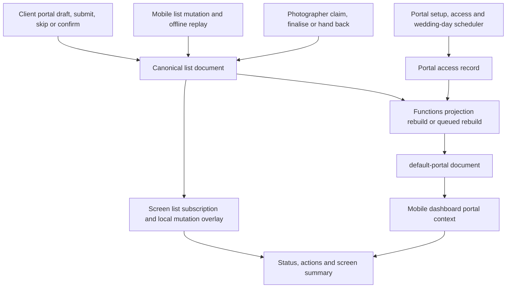

# Shared data flows and plan access

All six screen reports use the clean `stabilize` checkout at `9ac94ac18630919f9709c010639c3b469c3f12e7`, verified against GitHub's branch ref. This is a source audit of the highlighted regions and the code that can change them. The screenshots show earlier UI states. Fixture values describe reproducible test inputs. Current production catalogue values, deployed versions, native rendering and real device outcomes require separate evidence.

## What the mobile UI reads

| Record | Fields relevant to the highlighted areas |
| --- | --- |
| `projects/{id}` and owner settings | Project `eventDate` and owner timezone feed calendar phase `upcoming`, `eventDay`, or `complete`. Functions resolve the owner timezone for write guards. Missing dates are generally treated as upcoming for planning but cannot create timeline preview bounds or support date-dependent actions. |
| `portalAccess/{id}` | Server access and setup record. `isEnabled` boolean, `accessStatus` enum `active / disabled / expired / finalized`, `expiresAt` timestamp, and `selectedSteps` distinguish a configured, shared section from one the client can access. Step selection and required/optional configuration govern the portal journey. A scheduler disables access on wedding day. |
| `projects/{id}/clientPortal/default-portal` | Mobile portal projection. `steps[]` includes section ID, `stepStatus`, `actionOn`, and step metadata. Projection computes ownership from canonical section status and derives completion/current-step counts. In particular, canonical list `locked` projects as a portal step in `review`. It also carries access status, expiry and activity. |
| Canonical list docs | `projects/{id}/projectOnlyLists/{keyPeople,locations,timeline,photoRequests}` and `projects/{id}/lists/{groupShots,coupleShots}`. `items[]`; the shot lists also have `categories[]`. Per-section `config` carries status, lock/finalised fields, owner and workflow timestamps. Modern versions use `config.updatedAt`. See each screen report for item/config fields that affect its header. |
| `subscriptionPlans/{free,basic,pro,studio}` | Current plan document supplies feature flags and numeric limits. The app loads via its subscription cache, App Check and `useFeatureAccess`. The portal and callable authorization separately resolve current server entitlements and limits. Plan code and account write eligibility are separate inputs. |

Shared `config.status` values are `unlocked / review / locked / finalized`; `actionOn` values are `client / photographer / none`. The canonical parser uses an explicit valid status first, then legacy boolean `finalized` or `locked` when status is absent. Projection maps `unlocked` to client, `review` and `locked` to photographer, and `finalized` to none. Several mobile screens also read the raw flags. Legacy or partially updated docs can therefore yield different answers to “whose turn?” and “is it finalised?”. [Portal contract](C:/eye-doo-monorepo/packages/domain/src/portal-contract.ts:154) · [Projection](C:/eye-doo-monorepo/apps/functions/portal/portalProjection.ts:392) · [Mobile feature hook](C:/eye-doo-monorepo/apps/mobile/src/hooks/use-feature-access.ts:13)

## Plans and feature gates

These are the repository's **four-plan Maestro seed inputs**. All four seed mobile access to all six list surfaces. Runtime values are data-driven. A missing, disabled or changed flag can produce a different screen state from the seed for the same plan name.

| Seed input | Free trial | Basic | Pro | Studio |
| --- | --- | --- | --- | --- |
| Portal link duration | 5 days | 14 days | 28 days | 50 days |
| Entitled offline queue flag | Yes | No | Yes | Yes |
| Key People mobile / portal count | 8 / 8 | 2 / 2 | 4 / 4 | 8 / 8 |
| Locations mobile count | 10 | 10 | 10 | 10 |
| Timeline mobile / portal count | 15 / 15 | 6 / 6 | 10 / 10 | 15 / 15 |
| Photo requests mobile catalogue / client quota | 10 / 10 | 2 / 2 | 5 / 5 | 10 / 10 |
| Group client selection and estimate flags | Yes | Yes | Yes | Yes |
| Couple client selection and custom gallery flags | Yes | No | Yes | Yes |
| Timeline preview, dynamic and interactive flags | Yes | Yes | Yes | Yes |

The seed gives all four mobile Key People avatar limit 10 and photo request image limit 100. Resolved portal policy allows 6 locations when multiple locations are enabled and 1 otherwise. It sets Group and Couple portal quota to unlimited (-1). The older shared constants of 40 per shot list do not represent the resolved portal cap. The other shared defaults are 10 key people, 10 timeline events and 10 photo requests. Mobile and portal can count different things and impose different ceilings. Basic carries portal group selection and mobile Couple Shots access in this seed even though portal couple selection is off. The `showTimeEstimate` field touches the shot header/details when the underlying phase and entitlement allow. Seed `portalSync` and `realTimeSync` feature flags should not be read as proof that every individual selector or subscription checks them.

Free write access requires an active eligible trial with a valid end strictly after now. Expired Free retains read-only Projects access. Paid plans need verified store entitlement and a current writable subscription, plus account conditions for writes. The couple portal has a separate entitlement grace window (default seven days), subject to link lifecycle and owner/section guards. An apparent open or readable client link does not authorise portal writes. [Portal plan policy](C:/eye-doo-monorepo/packages/domain/src/project/portal-entitlements.schema.ts:121) · [Seed plan inputs](C:/eye-doo-monorepo/apps/mobile/scripts/seed-e2e-data.js:197) · [Plan schema](C:/eye-doo-monorepo/apps/mobile/src/domain/subscription/plan.schema.ts:184) · [Billing lifecycle](C:/eye-doo-monorepo/packages/domain/src/common/billing-values.ts:87) · [Release acceptance](C:/eye-doo-monorepo/docs/SHIP.md:16)

## How changes reach a screen

| Trigger | Persisted transition and effect |
| --- | --- |
| Client saves draft | Portal route/callable path verifies session, link, owner entitlement, selected section, event date, allowed transition and quota. Section validators merge client changes with protected photographer data and update metadata. Draft preserves the phase. Invalid fields, references, quota, session or ownership can reject the write. |
| Client submits | Portal API transaction validates and writes items and stats, sets `status: locked`, `actionOn: photographer`, server timestamps `clientSubmittedAt` and `updatedAt`, clears revision markers and the legacy lock. Shot submission also clears the separate capture check field for submitted rows. Projection/list listeners can arrive separately. |
| Client skips an optional step | Writes `status: finalized`, `finalized: true`, `actionOn: none`, `skipped`, `skippedByClient`, and `skippedAt`. Required steps cannot use this path. Skipped and approved sections can look identical in mobile guidance. |
| Client confirms review | Guarded portal endpoint for the corresponding review/unlock transition with client ownership. Clears the revision markers, sets `unlocked / client` and `clientReviewConfirmedAt`. This path does not stand for photographer approval. |
| Photographer claims | Authenticated `claimPortalSection` checks owner, plan, configured selected step and canonical unlocked state. Writes `locked / photographer` and clears revision markers. `reopenFinalized: true` is limited to Key People and Locations before the wedding day and clears `finalized`. It can work after the link closes under the remaining guards. Neither normal claim nor reopen creates a new client submission. |
| Photographer finalises or hands back | The shared Functions guard at this commit requires selected, pre-wedding, non-finalised, canonical **locked** and stored **photographer**. Finalise sets `finalized / none`, `approvedAt`, `approvedBy`; hand-back sets `unlocked / client`, `revisionRequested`, sanitized `revisionReason`, requester/time, and clears the client confirmation marker. Both await projection rebuild after the transaction. Some screen-specific mutations have their own route, particularly Locations geocoding and Timeline's local path. |
| Portal closure or access changes | Setup/management, disable/enable, extension, expiry, closure/finalisation, plan changes or the wedding-day scheduler affect client eligibility. A stored section can remain finalised or stay photographer-owned independently. Date-sensitive guards can change before a cached projection or screen rerenders. |

[Draft callable](C:/eye-doo-monorepo/apps/functions/portal/section/draftCallables.ts:23) · [Submit API](<C:/eye-doo-monorepo/apps/portal/src/app/api/wedding/[projectId]/section/[sectionId]/submit/route.ts:391>) · [Skip API](<C:/eye-doo-monorepo/apps/portal/src/app/api/wedding/[projectId]/section/[sectionId]/skip/route.ts:118>) · [Confirm review API](<C:/eye-doo-monorepo/apps/portal/src/app/api/wedding/[projectId]/section/[sectionId]/confirm-review/route.ts:74>) · [Photographer callables](C:/eye-doo-monorepo/apps/functions/portal/section/sectionCallables.ts:44) · [Projection triggers](C:/eye-doo-monorepo/apps/functions/portal/triggers/portalTriggers.ts:327)

## Saving, reload, and conflicts

- The independent list and portal listeners make precedence observable. A list can already show a queued edit, geocode or local lock while the portal header still shows the old turn. A fresh projection can also arrive before list config. Pull-to-refresh or a successful portal action may reread both. A read error on first load and a refresh error with usable data are distinct UI paths.
- Supported mobile mutations use the persist-first outbox on entitled accounts, even while connected. Success can initially mean durable on-device acceptance and an optimistic overlay. Without the queue entitlement the app requires connectivity for these writes. Direct portal workflow callables, network geocoding, and uploads have their own connectivity and pending semantics.
- `applyMobileMutation` revalidates ownership, write entitlement, dates, section status and quotas in a transaction. Entity/document replacements use version checks such as `baseUpdatedAt`. Field-level patches compare affected base values so unrelated updates can merge. Receipts identify replay, and a missing/changed remote item can return `remote_deleted` or `conflict`. Ownership change or finalisation during offline editing can reject replay even if the local edit initially appeared accepted.
- The mobile portal finalise wrapper first attempts to flush the section outbox and returns a connectivity-style error if any work remains. Takeover and hand-back call directly, so pending writes can subsequently fail against the changed owner. [Portal repository](C:/eye-doo-monorepo/apps/mobile/src/repositories/firestore/firestore-portal-repository.ts:764)
- Retrying an eligible failed write and refreshing displayed data are different operations. The queue serializes affected entity work, reports pending/retrying/failed/conflict, and offers explicit withdrawal of queued changes via the existing offline UI. A hand-back or approval transaction can commit before an awaited projection rebuild fails. Reconcile the canonical document and projection before interpreting a retry failure as proof that the first mutation never applied.

[Offline executor](C:/eye-doo-monorepo/apps/mobile/src/services/offline/offline-sync-executor.ts:27) · [Queue replay](C:/eye-doo-monorepo/apps/mobile/src/services/offline/offline-sync-queue.ts:450) · [Mutation validation](C:/eye-doo-monorepo/apps/functions/mobileMutationCallables.ts:371) · [Ownership policy](C:/eye-doo-monorepo/apps/functions/mobileMutationPolicy.ts:30) · [Projection queue](C:/eye-doo-monorepo/apps/functions/portal/portalProjectionQueue.ts:79)

## Notifications and portal-wide changes

Section-submitted triggers watch both canonical list collections. They claim an eligible submission before notifying the photographer and request projection work. Finishing every selected canonical section can mark the entire portal `finalized`, set `isEnabled: false`, delete `accessTokenHash` and timestamp closure. Reopening only a list leaves that portal access record closed. Client activity tracking separately updates projected last activity and throttles counted visits. Activity counts have no direct role in the six headers. [Submission and finalisation triggers](C:/eye-doo-monorepo/apps/functions/portal/triggers/portalTriggers.ts:125) · [Closure](C:/eye-doo-monorepo/apps/functions/portal/triggers/portalTriggers.ts:259) · [Client activity](C:/eye-doo-monorepo/apps/functions/portal/token/trackPortalAccess.ts:44)

The client store tracks saving, per-section draft sync, errors, rate limiting and loading. Submit or skip may advance client UI optimistically, and refresh reconciles the server state. A client-side saving indicator is not passed to mobile; the mobile header only changes after receiving data or its own pending state changes. [Client store](C:/eye-doo-monorepo/apps/portal/src/store/usePortalStore.ts:818)

